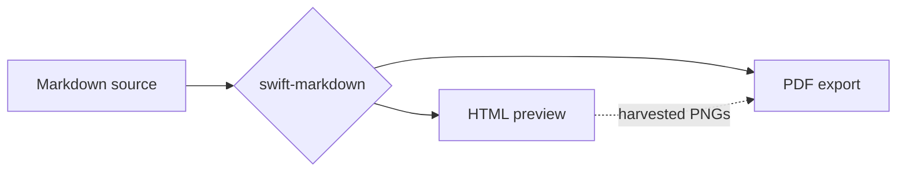

# MarkdownEditor

Welcome to **MarkdownEditor**, built on **swift-markdown**. Type on the left, watch the
*HTML preview* on the right, and export a Core Graphics PDF with
**Export as PDF…** (⌥⌘E) or a standalone HTML file (⇧⌘E). It supports
~~old-school~~ GitHub Flavored Markdown: `inline code`,
[links](https://developer.apple.com/documentation/), tables, task lists and more.

Try the editor: ⌃Space opens IntelliSense (type `\` inside a formula, or a
diagram keyword inside a mermaid block), ⌘B / ⌘I format the selection, Return
continues lists, Tab aligns tables, ⌥⌘1 / 2 / 3 switch between editor,
split and preview.

## Lists

- Parse the Markdown **once** into an AST
- Feed the same tree to every renderer
  - HTML via a `MarkupVisitor`
  - PDF via Core Text
- Ship no third-party PDF engine

1. Open a file with **File ▸ Open…** (⌘O)
2. Edit it in the left pane
3. Watch the preview update live

- [x] Highlight C#, JavaScript, TypeScript and Python
- [x] Render mermaid diagrams in the preview
- [x] Typeset LaTeX `$$ … $$` blocks with MathJax
- [x] Typeset inline `$ … $` when it is valid LaTeX, leave `$5`/`$10` alone
- [ ] Split blocks across PDF pages (out of scope)

## Table

| Renderer | Target | Framework |
| --- | :---: | ---: |
| `HtmlRenderer` | HTML | WebKit |
| `PdfDocumentRenderer` | PDF | Core Text |

> The AST is output-agnostic: the HTML preview and the PDF both come from the
> same syntax tree. That is the whole point of this design.

## C&#35;

```csharp
using System.Text.Json;

namespace Demo;

/// <summary>Loads and renders Markdown documents.</summary>
public sealed record Document(string Title, int Words)
{
    public static async Task<Document> LoadAsync(string path)
    {
        // Read the file and count the words.
        var text = await File.ReadAllTextAsync(path);
        var words = text.Split(' ', StringSplitOptions.RemoveEmptyEntries);
        return new Document($"Loaded {path}", words.Length);
    }

#if DEBUG
    public override string ToString() => @"C:\docs\" + Title;
#endif
}
```

## JavaScript

```javascript
// Debounce: only render after typing pauses.
function debounce(fn, delay = 300) {
  let timer = null;
  return (...args) => {
    clearTimeout(timer);
    timer = setTimeout(() => fn(...args), delay);
  };
}

const render = debounce(() => {
  console.log(`rendered at ${Date.now()}`);
});
```

## TypeScript

```typescript
interface Renderer {
  readonly name: string;
  render(ast: unknown): string;
}

type Registry = Map<string, Renderer>;

export function register(registry: Registry, renderer: Renderer): void {
  /* one tokenizer, every output */
  registry.set(renderer.name, renderer);
}
```

## Python

```python
from dataclasses import dataclass


@dataclass
class Block:
    """One block-level element of the AST."""
    kind: str
    depth: int = 0

    def describe(self) -> str:
        # f-strings are colored like other strings
        return f"{self.kind} at depth {self.depth}"


print(Block("heading", 1).describe())
```

## Mathematik (LaTeX)

Blöcke zwischen `$$` werden als LaTeX gesetzt — in der HTML-Vorschau und im
PDF-Export durch MathJax:

$$
M_{\mathrm{physisch,nutzbar}} \geq
M_{\mathrm{OS/sonstig}}+M_{\mathrm{Gewichte}}+M_{\mathrm{KV}}
+M_{\mathrm{Aktivierungen/Workspace}}+M_{\mathrm{Embedding}}+M_{\mathrm{Reserve}}.
$$

Environments, Brüche, Summen und Matrizen funktionieren ebenso; eine Nummer
gibt es nur mit einem ausdrücklichen `\tag{…}`:

$$
\begin{aligned}
\operatorname{softmax}(x)_i &= \frac{e^{x_i}}{\sum_{j=1}^{n} e^{x_j}} \\
\nabla_\theta \mathcal{L} &= -\frac{1}{N}\sum_{k=1}^{N} \nabla_\theta \log p_\theta(y_k \mid x_k)
\end{aligned}
\tag{1}
$$

Kurze Formeln dürfen auch auf einer Zeile stehen — der Block muss aber mit
`$$` **beginnen**, sonst ist es Fließtext:

$$ \int_0^\infty e^{-x^2}\,dx = \tfrac{\sqrt{\pi}}{2} $$

### Inline

Zwischen einfachen `$` steht Mathematik mitten im Satz: sei $x \in \mathbb{R}$
die $n$-te Komponente, dann gilt $e^{i\pi} + 1 = 0$ und
$\sum_{k=1}^{n} k = \tfrac{n(n+1)}{2}$ — auch in **fetten** Abschnitten, in
Tabellen und in Überschriften.

#### Auch in einer Überschrift wie $\Delta t \to 0$

| Größe | Formel | Einheit |
| --- | --- | --- |
| Fläche | $A = \pi r^2$ | m² |
| Impuls | $p = m v$ | kg·m/s |

Geprüft wird jeder Kandidat zuerst auf strukturelle LaTeX-Gültigkeit. Was
durchfällt, bleibt wörtlich stehen: ein Artikel für $5 und einer für $10,
`$PATH` in Code, $\frac{a}{b$ mit fehlender Klammer, $50% Rabatt$ mit einem
TeX-Kommentarzeichen.

## Mermaid



---

That's it — edit this text, open your own file, or export the PDF and compare
it with the preview.
